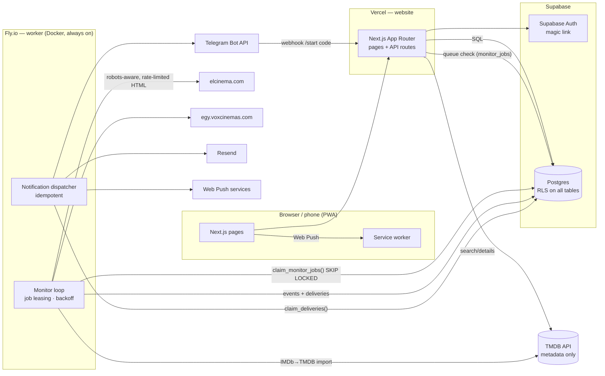

# 🎬 Cinema Radar Egypt

Search any movie in Arabic or English, see where it's playing in Egypt, and get an **email, phone push, or Telegram alert the moment tickets become bookable**, with a verified link into the cinema's official booking flow.

- **Live sources:** elCinema.com (multi-chain, covers Zawya and several Galaxy branches), VOX Cinemas Egypt, and Scene Cinemas (Cairo Festival City, District 5). See [docs/PROVIDERS.md](docs/PROVIDERS.md) for what each one does and doesn't cover.
- **Runs 24/7** in a separate worker. Your laptop and browser can be off.
- **Honest statuses:** a failed provider check shows "Provider temporarily unavailable", never "no tickets". "Bookable" means a real booking action was found. Booking links are only ever ones observed on the provider.

## Architecture



**Monitoring flow:** the website never scrapes. It only queues jobs. The worker:
1. Every **5 min**: fetches elCinema's "available for booking" index (1 request) and fast-tracks any watched movie that just appeared.
2. Every **5 min** per watched movie, deduplicated across users: fetches each provider's listing, stores screenings, and computes status (`upcoming`, `released_not_listed`, `listed_not_bookable`, `advance_booking`, `bookable_now`, `no_longer_listed`, `provider_unavailable`, `unknown`).
3. When branches newly start selling: verifies the booking link (elCinema: fetches the booking form; VOX: session link seen on the official page, since robots.txt disallows fetching it), writes **one** `notification_event` (unique `dedupe_key`) and records `notified_branches`, then fans out one delivery per user per channel (unique `(event, user, channel)`).
4. The dispatcher sends deliveries with retries and exponential backoff. Resend calls use the delivery id as the idempotency key, so a crash can't double-send.
5. Every **30 min**: catalogue sync (now playing / coming soon) and IMDb→TMDB import. Everything playing in Egypt is refreshed hourly for the Cinema Explorer.

The interval stretches automatically if the watchlist grows past the providers' polite request budget. The admin dashboard shows the effective interval.

## Pages
| Route | |
|---|---|
| `/` | Search with autocomplete (EN/AR), recently opened bookings, now showing in Egypt, coming soon, trending |
| `/movie/[tmdbId]` | Poster, trailer, cast, Egyptian release date, per-provider status, bookable branches with showtimes and **Book** buttons, listed-only cinemas, **Notify me** |
| `/watchlist` | Tracked movies with live status, last/next check, pause/remove |
| `/cinemas` | Cinema explorer: filter by city, chain, date, online-bookable |
| `/notifications` | Alert history with per-channel delivery status and booking links |
| `/settings` | Email, push (per device), Telegram link, preferred cities/chains, alert types, test buttons |
| `/providers` | Public coverage dashboard (working / partial / unavailable / not integrated, plus health) |
| `/admin` | Worker heartbeat, provider health, job queue, failed checks, delivery log, "run all now", "retry failed" |
| `/api/health` | DB + worker heartbeat + provider health (200/503) |

## Tech stack, and changes from the brief
- **Next.js 15 (App Router, TypeScript) + Tailwind 4**: as requested.
- **shadcn/ui → equivalent in-repo components** (`src/components/ui.tsx`): same variant API, no CLI scaffolding or Radix dependency needed for this UI.
- **Supabase Postgres + Auth**: auth uses email magic links. Server code uses `pg` over `DATABASE_URL` and enforces ownership in code. RLS is enabled on every table so the public anon key can only read public catalogue data and a user's own rows.
- **Web Push (VAPID) instead of Firebase**: one standard covers Chrome/Edge/Firefox/Android and iOS 16.4+ home-screen apps, with no Firebase project to manage.
- **Worker on Fly.io (Docker)** instead of serverless cron: a long-lived process with DB-leased jobs is simpler and more reliable for 5-minute polling with per-host rate limits. `docker-compose.yml` runs it on any VPS.
- **Playwright not used for scraping:** both providers serve the needed data in static HTML. Playwright is used only for E2E tests.

## Local development
```bash
npm install
cp .env.example .env.local          # fill in Supabase/TMDB/Resend values
npm run dev                         # website on http://localhost:3000
npm run worker:dev                  # monitoring worker (reads .env.local)
```
No Supabase project yet? `npm run db:local` starts a real Postgres (PGlite, in-process) on `127.0.0.1:54329` with the migration applied. It's handy for the worker and tests. Sign-in still needs Supabase.

## Running for $0
See **[docs/ZERO_COST.md](docs/ZERO_COST.md)**: service audit, free-tier limits and measured usage, architecture comparison,
what can't be done for free, and the roadmap. Live usage projections are on **/admin → Free-tier usage**.
Cadence: elCinema's bookable list every 2 min (earliest advance-booking signal), watched movies every 5 min,
everything else showing in Egypt every 6 h. Timing is best-effort; free tiers give no guarantees.

## Deployment (free: Vercel + Supabase cron) — the live setup
No always-on server is needed. Supabase `pg_cron` calls `POST /api/cron/tick` every minute
(authenticated with `CRON_SECRET`); each tick takes a database lock, runs due jobs for up
to ~4 minutes on Vercel (Hobby allows 300 s per function), and sends due notifications.
```bash
npm run db:migrate                                   # tables + pg_cron/pg_net
npx vercel link --yes --project cinema-radar-egypt   # with VERCEL_TOKEN
node scripts/vercel-env.mjs https://cinema-radar-egypt.vercel.app   # copies .env.local → Vercel (values never printed)
npx vercel deploy --prod
APP_URL=https://cinema-radar-egypt.vercel.app npx tsx --env-file=.env.local scripts/schedule-cron.ts
```
Then in Supabase → Auth → URL Configuration set the Site URL to the live URL and allow `<live URL>/**` as a redirect.
Note: Scene Cinemas blocks cloud-hosting IP addresses (HTTP 403), so from Vercel Scene shows as temporarily unavailable.

## Deployment (alternative: always-on worker)
1. **Supabase:** create a project. Run [`supabase/migrations/0001_init.sql`](supabase/migrations/0001_init.sql) in the SQL editor (or `supabase db push`). Under *Auth → URL configuration*, set Site URL to your `APP_URL` and add `APP_URL/auth/callback` to redirect URLs. Optionally set Supabase Auth SMTP to Resend so magic links come from your domain.
2. **Resend:** verify your sending domain and create an API key. Set `EMAIL_FROM` on that domain.
3. **VAPID keys:** `npm run vapid:generate`, then put the public and private keys in env.
4. **Website → Vercel:** import the repo and add every variable from `.env.example` (`DATABASE_URL` = transaction pooler, port 6543). Deploy.
5. **Worker → Fly.io:**
   ```bash
   fly launch --no-deploy --copy-config --name cinema-radar-worker
   fly secrets set DATABASE_URL=... TMDB_READ_TOKEN=... RESEND_API_KEY=... EMAIL_FROM=... \
     NEXT_PUBLIC_VAPID_PUBLIC_KEY=... VAPID_PRIVATE_KEY=... VAPID_SUBJECT=... APP_URL=... \
     NEXT_PUBLIC_SUPABASE_URL=... NEXT_PUBLIC_SUPABASE_ANON_KEY=... SCRAPER_CONTACT=... \
     TELEGRAM_BOT_TOKEN=...   # optional
   fly deploy
   fly logs                  # watch "job elcinema:bookable_index ok"
   ```
   Fly restarts the machine on crash. Leased jobs expire and are picked up again after a restart.
6. **Telegram (optional):** create a bot with @BotFather and set `TELEGRAM_*`. Then register the webhook:
   `https://api.telegram.org/bot<TOKEN>/setWebhook?url=<APP_URL>/api/telegram/webhook&secret_token=<TELEGRAM_WEBHOOK_SECRET>`
7. **Admin:** add your email to `ADMIN_EMAILS` and open `/admin`.
8. **Uptime:** point any monitor (e.g. UptimeRobot) at `APP_URL/api/health`. It returns 503 if the worker heartbeat is older than 2 minutes or elCinema is failing repeatedly.

## Testing
```bash
npm test                  # unit + provider-adapter tests (parsers run against real saved pages)
npm run typecheck && npm run lint
npm run smoke:elcinema    # live: fetch elCinema, parse a bookable movie, verify one booking URL
npm run db:local          # in another terminal
DATABASE_URL=postgres://postgres@127.0.0.1:54329/postgres npm run test:integration
                          # live end-to-end monitor run: link → listings → status → verified event → deliveries → no duplicates
npm run build && npm start   # then:
npx playwright test       # E2E on desktop + mobile viewports (BASE_URL=... to target a deployment)
E2E_TMDB=1 npx playwright test   # also runs search → movie page (needs TMDB on the server)
```

**Full acceptance test (production):**
1. Sign in at `/login` with your email. In `/settings`, press *Send test email*, *Enable on this device*, then *Send test push*.
2. Search a movie that is **upcoming** in Egypt (Home → Coming soon) and tap **Notify me**.
3. Close the laptop. The Fly worker keeps checking.
4. When a supported cinema opens booking, you get email/push/Telegram with the branch, date, times and a **Book now** link that opens elCinema's or VOX's official booking page.
5. `/notifications` shows the alert and its delivery status, and `/admin` shows the run that detected it.

## Security notes
- Secrets only exist in server env (Vercel/Fly). Only `NEXT_PUBLIC_SUPABASE_*` and the VAPID **public** key reach browsers.
- Every mutating API route requires a verified Supabase session (`auth.getUser()`), validates input with zod, and scopes queries to the user. Admin routes also check `ADMIN_EMAILS` / `profiles.is_admin`.
- The Telegram webhook requires the secret header (constant-time compare). Linking uses one-time codes.
- RLS: users can read and write only their own preferences, watchlist and push subscriptions, and read only their own deliveries. Monitoring tables have no policies (no API access).
- Alert HTML is escaped. Booking URLs are only accepted when they match each provider's own booking URL pattern.
